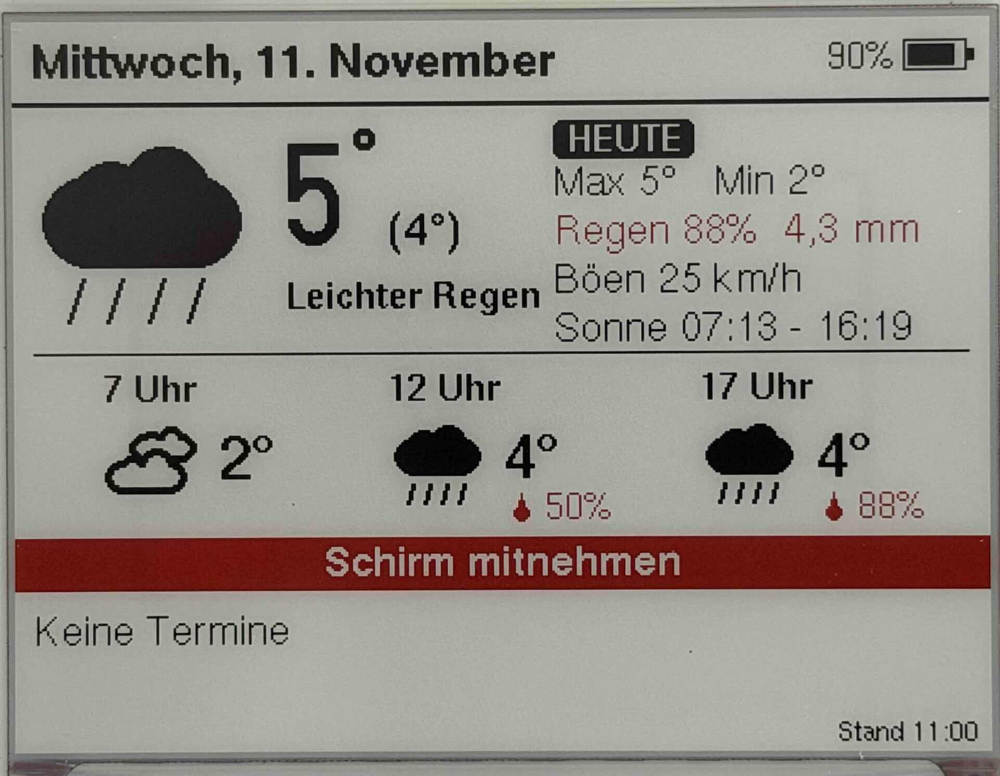
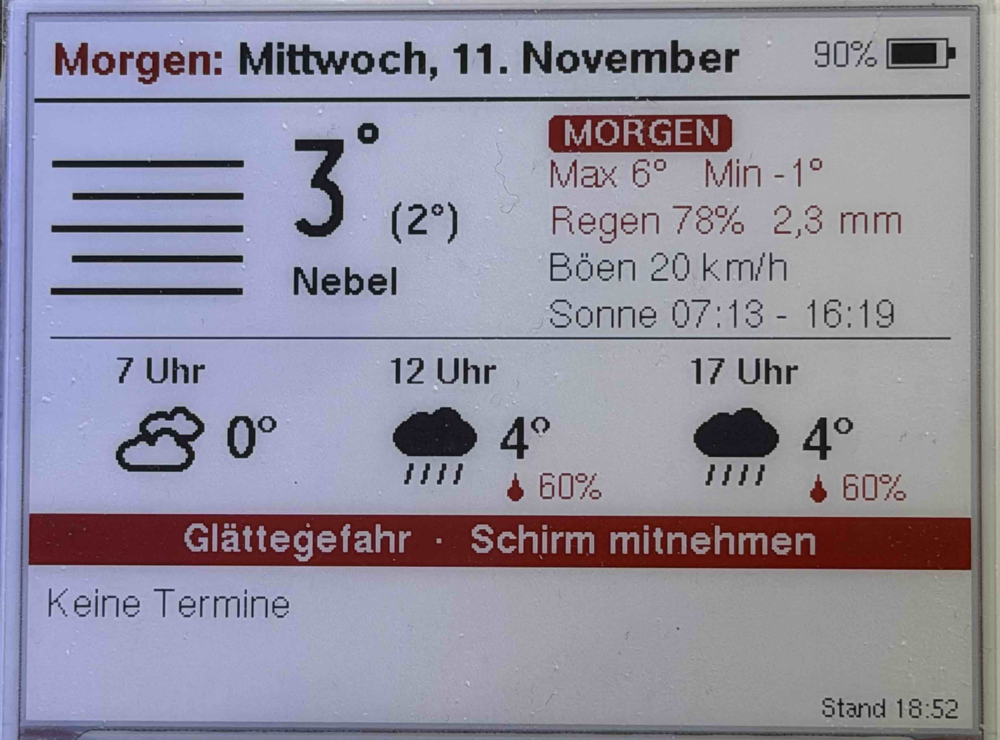

<p align="center">
  <a href="https://docbigs-lab.de">
    
  </a>
</p>
<p align="center">
  <a href="https://docbigs-lab.de">https://docbigs-lab.de</a>
</p>

# E-Paper-Wetteranzeige mit Terminen (ESP32-C6)

> **English summary:** Battery-powered 4.2" e-paper display (black/white/red) on a Seengreat ESP32-C6 E-Paper Driver Board. It shows the weather forecast from Open-Meteo, the outdoor temperature and upcoming appointments from Home Assistant, and a reminder the day before waste collection. The board wakes up hourly and only redraws when the content has changed. After three small hardware modifications the deep sleep current drops from 3.2 mA to about 70 µA, and a 3000 mAh cell lasts roughly 14 months. This README is in German. The hardware notes, including the board modifications and power measurements, are available in English: [docs/hardware.en.md](docs/hardware.en.md)

Akkubetriebene Anzeige für den Flur: Ein 4,2"-E-Paper-Display (schwarz/weiß/rot) zeigt die aktuelle Außentemperatur, die Wettervorhersage für den Tag und die anstehenden Termine, z. B. die Müllabfuhr. Ab 18 Uhr zeigt es die Vorschau auf den nächsten Tag.

- Wetter von [Open-Meteo](https://open-meteo.com) (kostenlos, ohne API-Schlüssel)
- Gemessene Außentemperatur und Termine aus [Home Assistant](https://www.home-assistant.io)
- ESP32-C6 im Deep Sleep, wacht stündlich auf und zeichnet nur neu, wenn sich etwas geändert hat

<!-- Foto: docs/bilder/heute.jpg. Neue Fotos vorher von Standortdaten (EXIF/GPS) befreien!
     Handy-Originale (IMG_*) ignoriert git. -->




## Was angezeigt wird

```
┌───────────────────────────────────────────────────────┐
│ Donnerstag, 5. November                   80% [Akku]  │  ab 18 Uhr: "Morgen: Freitag, ..."
├──────────┬────────────────┬───────────────────────────┤
│          │  5°  (5°)      │ [HEUTE]                   │  ab 18 Uhr: [MORGEN] in Rot
│ [Symbol] │                │ Max 9°   Min -2°          │
│          │  Klar          │ Regen 0%   0,0 mm         │
│          │                │ Böen 21 km/h              │
│          │                │ Sonne 07:02 - 16:29       │
├──────────┴────────────────┴───────────────────────────┤
│  7 Uhr  [S] -2°     12 Uhr  [S] 7°     17 Uhr  [S] 5° │
├───────────────────────────────────────────────────────┤
│                    Glättegefahr                       │  rote Zeile, nur bei Warnung
│ ┏━━━━━━━━━━━━━━━━━━━━━━━━━━━━━━━━━━━━━━━━━━━━━━━━━━━┓ │
│ ┃ [Tonne] Heute Abend rausstellen: Gelbe Tonne      ┃ │  roter Rahmen, am Tag vor der Abfuhr
│ ┗━━━━━━━━━━━━━━━━━━━━━━━━━━━━━━━━━━━━━━━━━━━━━━━━━━━┛ │
├───────────────────────────────────────────────────────┤
│ Heute    Gelbe Tonne                                  │  Termine des angezeigten Tags in Rot
│ Morgen   15:30 Zahnarzt                               │
│ So 8.    Biotonne                          Stand 10:28│
└───────────────────────────────────────────────────────┘
```

| Bereich | Inhalt |
|---|---|
| **Links: jetzt** | Symbol und Beschreibung des aktuellen Wetters, nachts mit Mond. Groß die in Home Assistant gemessene Außentemperatur, daneben in Klammern die Vorhersage. Ohne Messwert steht nur die Vorhersage groß da. |
| **Rechts** | Etikett „HEUTE“ (schwarz) bzw. „MORGEN“ (rot), darunter Max/Min, Regen, Böen, Sonnenauf- und -untergang des angezeigten Tags (bis 18 Uhr heute, danach morgen) |
| **Mitte** | Vorhersage für 7, 12 und 17 Uhr. Die Regenwahrscheinlichkeit erscheint erst ab 10 %. |
| **Warnzeile** | Gewitter, Glättegefahr, Schnee, „Schirm mitnehmen“, Sturmböen. In der Tagesansicht zählen die Stunden von jetzt bis 18 Uhr, in der Abendansicht von jetzt bis morgen 24 Uhr. |
| **Müll-Banner** | Am ganzen Tag vor einer Abfuhr (5–22 Uhr): „Heute Abend rausstellen: …“ mit rotem Rahmen und Tonnen-Symbol, weil die Tonnen früh am Morgen abgeholt werden. Grundlage sind die Termine aus `HA_KALENDER_MUELL`. |
| **Termine** | Die nächsten 7 Tage aus den Home-Assistant-Kalendern. Ganztägige Termine stehen vor denen mit Uhrzeit. Termine mit Uhrzeit verschwinden bei der ersten Aktualisierung nach ihrem Beginn. Tonnen, die im Banner stehen, erscheinen nicht noch einmal in der Liste. Passen nicht alle Termine aufs Display, steht in der letzten Zeile „+ N weitere Termine“. |
| **Stand** | Uhrzeit, zu der zuletzt neu gezeichnet wurde (nicht der letzte Abruf) |

Rot hervorgehoben werden der Tiefstwert bei Frost (≤ 1 °C), Regen ab 50 %, Böen ab 50 km/h, die Termine des angezeigten Tags und ein Akkustand unter 3,5 V.

## Ablauf

1. Aufwachen, WLAN verbinden, Uhrzeit per NTP holen
2. Wetter von Open-Meteo, Außentemperatur und Termine von Home Assistant abrufen
3. WLAN komplett aus (auch im Fehlerfall vor der Fehleranzeige), damit der Funk während des Refreshs keinen Strom zieht
4. Prüfsumme über den gesamten Inhalt bilden. Neu gezeichnet wird nur, wenn sie sich geändert hat. Ein voller Refresh dauert etwa 23 s, das Display flackert dabei.
5. Deep Sleep bis zum nächsten Zeitpunkt: **stündlich von 5 bis 22 Uhr**. Nachts wird nicht aktualisiert.

Mit der Reset-Taste wird sofort aktualisiert und immer neu gezeichnet.

Bei einem Fehler (kein WLAN, keine Uhrzeit, keine Wetterdaten) versucht es das Board nach 30 Minuten erneut. Nach dem Aufwachen bleibt die alte Anzeige bei einzelnen Aussetzern stehen. Die Fehlermeldung erscheint erst beim dritten Fehler in Folge, nach einem Reset sofort.

Ist Home Assistant nicht erreichbar, läuft die Anzeige trotzdem weiter: Statt der Messung erscheint die Vorhersage, und statt der Termine steht in Rot „Termine nicht abrufbar“.

## Hardware

| Teil | Details |
|---|---|
| Board | [Seengreat ESP32-C6 E-Paper Driver Board](https://seengreat.com/wiki/198/esp32c6-e-paper-driver-board#toc15) (24-Pin-FPC, Li-Ion-Ladeschaltung) |
| Display | 4,2" BWR, 400×300, aus einem SES-imagotag-Preisschild, Controller UC8176 (Treiber `GxEPD2_420c`) |
| Akku | 1 Zelle Li-Ion/LiPo 3,7 V mit Schutzschaltung, im Einsatz: 3000 mAh, reicht gemessen etwa 14 Monate |

Pinbelegung, Display, Hinweise zum Akku und die nötigen Umbauten am Board für niedrigen Schlafstrom: [docs/hardware.md](docs/hardware.md)

### Stromverbrauch

Über 24 h gemessen (13./14.11.2026): **5,6 mAh pro Tag**, Ruhestrom Ø 71 µA. Mit 3000 mAh, davon 80 % nutzbar, reicht das für **etwa 430 Tage**. Ohne die Umbauten am Board (PWR-LED, R12, R2 entfernen) braucht es im Schlaf 3,2 mA, dann hält der Akku nur 5–6 Wochen.

Gemessen wurde mit einem Nordic Power Profiler Kit II am Raspberry Pi und dem [PPK2 Longterm Logger](https://github.com/DocBigs-Lab/ppk2-longterm-logger). Der läuft ohne PC über Tage, schreibt CSV-Dateien und kann die Werte per MQTT an Home Assistant schicken. Sein Skript `analyse.py` listet die Wachphasen mit Dauer und Ladung auf und rechnet die Akkulaufzeit hoch. Details und Messwerte: [docs/hardware.md](docs/hardware.md#langzeitmessung-mit-festen-pin-pegeln-1314112026)

## Einrichtung

### 1. Voraussetzungen

- [PlatformIO](https://platformio.org) (z. B. als VS-Code-Erweiterung)
- Die Plattform `pioarduino` wird automatisch geladen, der ESP32-C6 braucht den Arduino-Core 3.x.

### 2. Zugangsdaten

```sh
cp include/secrets.example.h include/secrets.h
```

In `include/secrets.h` eintragen:

| Eintrag | Bedeutung |
|---|---|
| `WIFI_SSID`, `WIFI_PASSWORD` | WLAN (2,4 GHz) |
| `WLAN_IP`, `WLAN_GATEWAY` | optional feste IP statt DHCP, spart pro Aufwachen die DHCP-Anfrage. Adresse außerhalb des DHCP-Bereichs wählen oder im Router reservieren. Fehlt eine der beiden oder ist sie ungültig, gilt DHCP. |
| `WLAN_MASKE`, `WLAN_DNS` | optional zur festen IP, Standard `255.255.255.0` bzw. das Gateway |
| `HA_URL` | z. B. `http://homeassistant.local:8123`. Falls `.local` nicht aufgelöst wird, die IP-Adresse eintragen. |
| `HA_TOKEN` | Langlebiger Zugangstoken: in HA unten links aufs Profil klicken, Reiter „Sicherheit“, „Langlebige Zugangstoken“ |
| `HA_SENSOR_AUSSEN` | Entity-ID des Außentemperatursensors, leer = nur Vorhersage |
| `HA_KALENDER_MUELL` | Kalender mit den Abfuhrterminen, z. B. aus einer Abfall-Integration. Am Vortag erscheint das Banner „Heute Abend rausstellen“. |
| `HA_KALENDER` | Übrige Kalender, mehrere mit Komma: `"calendar.a,calendar.b"`, leer = keine |
| `ORT_LAT`, `ORT_LON` | Koordinaten für die Wettervorhersage (Pflicht) |

`secrets.h` steht in der `.gitignore` und wird nicht eingecheckt. Ohne `HA_URL`/`HA_TOKEN` läuft die Anzeige nur mit Open-Meteo.

### 3. Einstellungen

Alles Weitere steht in [src/wetter/config.h](src/wetter/config.h):

| Einstellung | Standard | Bedeutung |
|---|---|---|
| `AKTIV_VON_H`, `AKTIV_BIS_H` | 5, 22 | Zeitfenster für Aktualisierungen |
| `INTERVALL_MIN` | 60 | Abstand der Aktualisierungen |
| `UPDATE_EXTRA_H`, `UPDATE_EXTRA_M` | aus (-1) | optionaler zusätzlicher Zeitpunkt, z. B. 5:30 |
| `MORGEN_AB_STUNDE` | 18 | ab hier Vorschau auf morgen |
| `SLOT_1_H` … `SLOT_3_H` | 7, 12, 17 | Stunden der drei Vorhersage-Spalten |
| `WARN_FROST_C`, `WARN_REGEN_PROZENT`, `WARN_BOEEN_KMH` | 1 °C, 50 %, 50 km/h | Warnschwellen |
| `HA_MAX_ALTER_MIN` | 120 | ältere Messwerte werden ignoriert (z. B. Sensor-Batterie leer) |
| `WLAN_SENDELEISTUNG` | 8,5 dBm | reduzierte Sendeleistung für einen Router in der Nähe. Werte `WIFI_POWER_2dBm` … `WIFI_POWER_21dBm`, Zeile auskommentieren = Maximum. Ist der RSSI im Log schlechter als etwa −70 dBm, erhöhen. |
| `TERMINE_TAGE` | 7 | Zeitraum der Terminabfrage ab heute |
| `AKKU_*` | – | Spannungsgrenzen für die Akkuanzeige |

### 4. Hochladen

```sh
pio run -e wetter42 -t upload
pio device monitor
```

Das Board liegt fast immer im Deep Sleep, dann ist die USB-Verbindung weg. Zum Hochladen:

1. **BOOT** gedrückt halten, **RST** kurz drücken, BOOT loslassen
2. Hochladen
3. Danach **RST** drücken, damit das Programm startet

Zum Testen lässt sich der Zeitplan überbrücken. Dazu in `platformio.ini` unter `[env:wetter42]` einkommentieren:

```ini
build_flags = ${env.build_flags} -D TEST_SCHLAF_MIN=5
```

## Home Assistant

Die Anzeige liest über die REST-API von Home Assistant. In HA muss dafür nichts eingerichtet werden außer dem Token.

| Zweck | Anfrage |
|---|---|
| Außentemperatur | `GET /api/states/<HA_SENSOR_AUSSEN>` |
| Termine | `GET /api/calendars/<entity>?start=…&end=…` (je Kalender aus `HA_KALENDER_MUELL` und `HA_KALENDER`) |

Weitere Kalender, etwa einen mit dem Apple-Kalender synchronisierten, einfach mit Komma an `HA_KALENDER` in `secrets.h` anhängen.

## Fehlersuche

Ausgaben im seriellen Monitor (115200 Baud):

| Meldung | Bedeutung |
|---|---|
| `WLAN verbunden nach 1200 ms, RSSI -45 dBm, Sendeleistung 8.5 dBm` | Verbindungszeit und Empfang. Bei schlechtem RSSI oder Verbindungsfehlern `WLAN_SENDELEISTUNG` erhöhen. |
| `Feste IP 192.168.178.50` | feste IP aus `secrets.h` aktiv |
| `Feste IP ungültig (secrets.h) - nutze DHCP` | Schreibfehler in `WLAN_IP`, `WLAN_GATEWAY`, `WLAN_MASKE` oder `WLAN_DNS` |
| `Akku: 4.31 V` | über 4,25 V gilt als „kein Akku, USB“ |
| `Außen gemessen (HA): nan°C` | Sensor nicht erreichbar, `unavailable` oder älter als `HA_MAX_ALTER_MIN` |
| `HA /api/...: HTTP 401` | Token falsch oder abgelaufen |
| `HA /api/...: HTTP 404` | Entity-ID falsch |
| `HA /api/...: HTTP -1` | HA nicht erreichbar, ggf. IP statt `homeassistant.local` eintragen |
| `Kalender calendar.x: 3 Termine` | Abruf in Ordnung |
| `Inhalt unverändert, Display bleibt wie es ist` | kein Neuzeichnen nötig |
| `[ERROR] ENXIO …` | kommt vom PlatformIO-Monitor, wenn das Board in den Deep Sleep geht, und ist normal |

## Verbesserungs- und Optimierungsmöglichkeiten

### Akkulaufzeit

Ausgangslage laut Messung mit festen Pin-Pegeln (13./14.11.2026): 5,6 mAh pro Tag, davon 3,9 mAh für 18 Wachphasen (alle mit Neuzeichnen, Ø 0,21 mAh) und 1,7 mAh Ruhestrom. Eine Wachphase ohne Neuzeichnen kostete in der Messung vom 8./9.11. 0,08 mAh, ein Neuzeichnen kostet also noch etwa 0,13 mAh extra. Die Ersparnisse unten sind Schätzungen auf dieser Grundlage.

| Möglichkeit | Aufwand | Ersparnis (geschätzt) | Laufzeit (3000 mAh × 80 %) |
|---|---|---|---|
| **Light Sleep während des Refreshs (umgesetzt):** Statt ~22 s wach auf BUSY zu warten, geht der ESP mit GxEPD2 `setBusyCallback` in den Light Sleep. Geschätzt waren ~0,17 mAh pro Neuzeichnen und ~390 Tage. | Firmware, gering | gemessen ~0,10 mAh pro Neuzeichnen, 1,7 mAh pro Tag | 267 → 330 Tage |
| **DC und LED-Pin im Deep Sleep fest auf HIGH (umgesetzt):** Die beiden Eingänge schwebten vorher und erhöhten den Ruhestrom, der zudem stundenweise zwischen 120 und 200 µA schwankte. | Firmware, gering | gemessen 1,7 mAh pro Tag (Ruhestrom 147 → 71 µA) | 330 → **432 Tage** |
| **Seltener neu zeichnen:** Temperaturen in der Prüfsumme mit Hysterese (z. B. erst ab 2 °C Änderung) oder nur die gemessene statt beider Temperaturen berücksichtigen | Firmware, gering | ~0,13 mAh je eingespartem Neuzeichnen | hängt vom Wetter ab, höchstens ~2,3 mAh pro Tag (~730 Tage) |
| **Längeres Intervall:** `INTERVALL_MIN` auf 120 (9 statt 18 Wachphasen) oder ein kürzeres Zeitfenster in `config.h` | nur Einstellung | ~1,9 mAh pro Tag | ~650 Tage |
| **Feste IP und reduzierte Sendeleistung (umgesetzt, wahlweise):** ohne DHCP-Anfrage, weniger Strom beim Senden (`WLAN_IP` in `secrets.h`, `WLAN_SENDELEISTUNG` in `config.h`) | Einstellung | nicht gemessen, vermutlich einige Prozent der WLAN-Energie | gering |
| **Kanal und BSSID merken:** im RTC-Speicher ablegen und an `WiFi.begin()` übergeben, dann entfällt die Suche nach dem Netz | Firmware, mittel | bis zu ~1 s bei ~55 mA pro Wachphase, nicht gemessen | gering |

Ein Teil-Refresh, der Strom und Flackern sparen würde, ist mit dem dreifarbigen Panel nicht möglich.

Am Ruhestrom ist ohne weitere Eingriffe am Board wenig zu holen. Die übrigen ~70 µA verteilen sich auf ESP, Spannungsregler, Akku-Spannungsteiler und das Panel im Deep Sleep (Aufschlüsselung in [docs/hardware.md](docs/hardware.md#schlafstrom-senken)).

Zum Prüfen einer Änderung genügt eine Messung über 24 h mit dem [PPK2 Longterm Logger](https://github.com/DocBigs-Lab/ppk2-longterm-logger). `analyse.py --raster 1800` zeigt auch, ob die Wachphasen pünktlich kommen und welche davon neu gezeichnet haben.

**Mein Fazit:** Mit einer Laufzeit von über einem Jahr pro Akkuladung bin ich zufrieden. Die Möglichkeiten oben bleiben als Ideen stehen, ich verfolge sie vorerst aber nicht weiter.

### Weitere Ideen

- **Akkustand an Home Assistant melden** (`POST /api/states/...`), damit HA vor einem leeren Akku warnt
- **Wachphasen in HA protokollieren** (Dauer, Fehler, ob neu gezeichnet), als Ergänzung zur Strommessung
- **Konfiguration aus HA lesen**, z. B. Intervall und Zeitfenster, ohne neu zu flashen

## Projektstruktur

```
platformio.ini            Build-Umgebungen (wetter42 = die Anzeige)
include/secrets.h         WLAN, HA-Zugang, Entity-IDs, Ort (nicht im Repo)
src/wetter/
  main.cpp                Ablauf, Layout, Zeitplan, Prüfsumme
  config.h                alle Einstellungen
  wetter.cpp/.h           Open-Meteo-Abruf, Warnlage aus Stundenwerten
  ha.cpp/.h               Home-Assistant-REST-Zugriff, Sensorwert
  termine.cpp/.h          Termine aus HA-Kalendern
  symbole.cpp/.h          Wettersymbole (gezeichnet, keine Bilddateien)
src/main_gxepd2.cpp       Testbild für das Panel (Umgebung epd42)
src/schlaftest.cpp        Board sofort in Deep Sleep, zum Messen des Schlafstroms (Umgebung schlaftest)
docs/hardware.md          Pins, Display, Akku, Stromverbrauch
docs/hardware.en.md       dasselbe auf Englisch
docs/bilder/              Fotos der Anzeige für die README
```

## Danke

Die E-Paper-Displays stammen aus ausgemusterten elektronischen Preisschildern. Ein Maker-Kollege hat sie mir zur Verfügung gestellt, ohne ihn gäbe es dieses Projekt nicht. Vielen Dank dafür! Du weißt, dass du gemeint bist. 😉

## Quellen und Lizenzen

- Dieses Projekt: [MIT-Lizenz](LICENSE)
- Wetterdaten: [Open-Meteo](https://open-meteo.com), Lizenz CC BY 4.0
- Display-Treiber: [GxEPD2](https://github.com/ZinggJM/GxEPD2), Schriften: [U8g2_for_Adafruit_GFX](https://github.com/olikraus/U8g2_for_Adafruit_GFX), JSON: [ArduinoJson](https://arduinojson.org)
