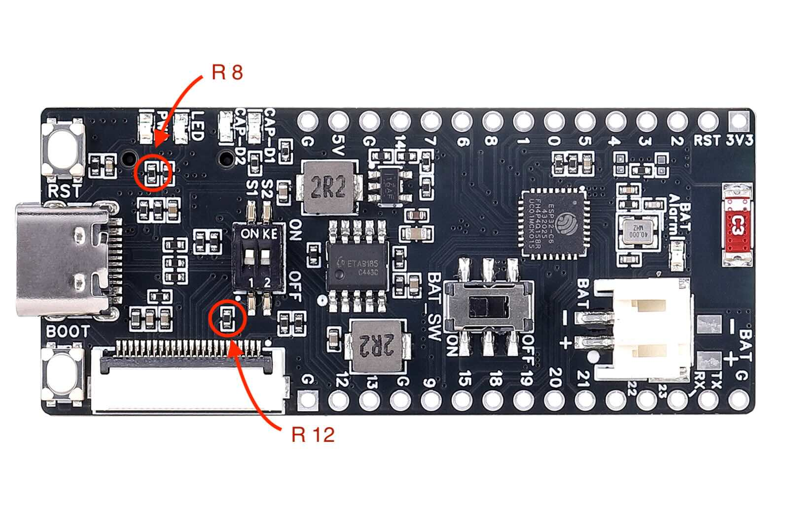
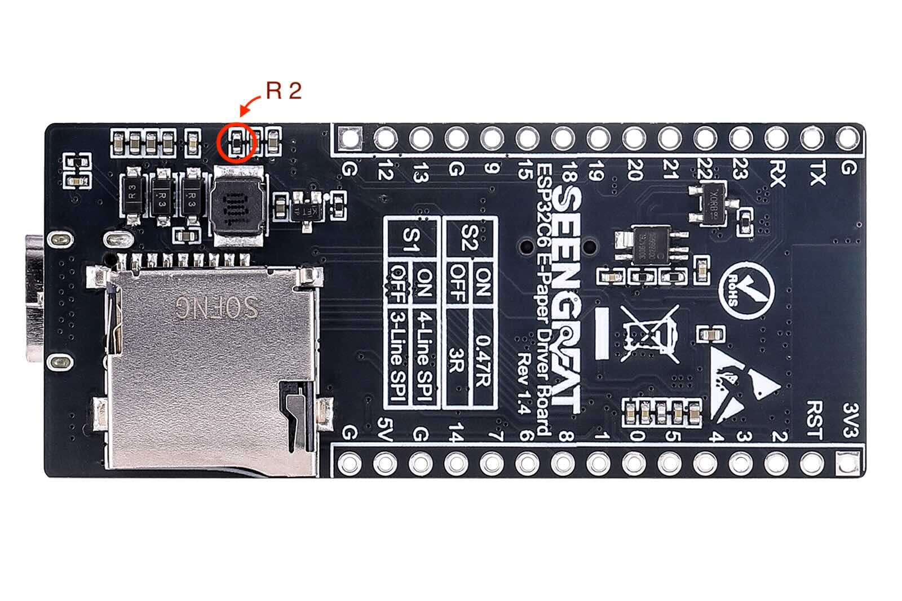
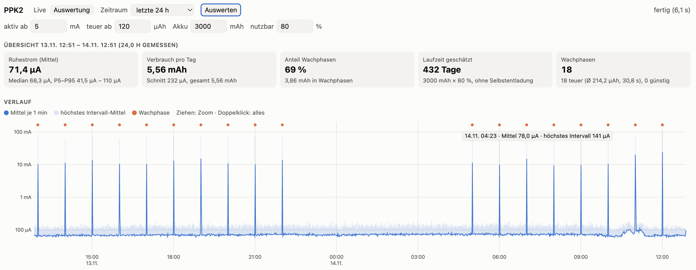

# Hardware

[Deutsch](hardware.md) | **English**

## Seengreat ESP32-C6 E-Paper Driver Board

Manufacturer wiki: [seengreat.com/wiki/198](https://seengreat.com/wiki/198/esp32c6-e-paper-driver-board#toc15)

Pin assignment from the Seengreat demos:

| Signal | GPIO |
|---|---|
| BUSY | 2 |
| DC | 3 |
| MOSI (SDA) | 4 |
| SCK | 5 |
| RST | 6 |
| CS | 7 |
| LED | 8 |
| Battery voltage (1:2 divider) | 0 |

The board uses an ESP32-C6 and therefore needs Arduino core 3.x. `platformio.ini` uses the `pioarduino` platform instead of the official `espressif32` for this.

## Display

The 4.2" panel (BWR, 400×300) comes from a SES-imagotag electronic shelf label. There is no datasheet. It works with the GxEPD2 driver `GxEPD2_420c` (UC8176 controller). The `epd42` environment in `platformio.ini` draws a test image, so you can check panel and wiring without WiFi or Home Assistant.

### Longer refresh

A full refresh takes about 23 s on this panel. GxEPD2 only waits 20 s for `GxEPD2_420c` and then reports "Busy Timeout!". The class `EPD_SES42` in `src/wetter/main.cpp` therefore raises the timeout to 40 s.

## Battery

- **Type:** one Li-ion/LiPo cell, 3.7 V nominal, 4.2 V full, **with protection circuit**. No LiFePO4, the charger charges to 4.2 V.
- **Connector:** check the polarity against the marking on the board before plugging in. JST-PH batteries are sold with both pin orders.
- **Measurement:** GPIO0 via a 1:2 divider. Without a battery the divider sees the charging voltage (above 4.25 V), and the display shows "USB".
- **Display:** in 5 % steps between 3.30 V (0 %) and 4.15 V (100 %), red below 3.50 V

### Measured consumption (Nordic PPK2, 6 Nov 2026)

Measurement with the power LED and R12 removed, R2 still fitted, display connected, no light sleep yet. The table shows what a cycle consists of. For current values and runtime see the [24-hour measurement with fixed pin levels](#24-hour-measurement-with-fixed-pin-levels-1314-nov-2026):

| Area | Item | Duration | Charge | Current / note |
|---|---|---|---|---|
| Cycle | Boot, WiFi, downloads | ~9 s | ~140 µAh | avg. 55 mA, peaks above 1 A |
| Cycle | Display refresh | ~22 s | ~190 µAh | constant ~32 mA, the ESP waits awake for BUSY |
| Cycle | Tail | ~22 s | negligible | median ~42 µA |
| Idle | Deep sleep | continuous | – | median ~0 µA, **mean 1.45 mA** due to pulses up to ~870 mA |

The cycle values come from a cold start. A wake cycle from deep sleep may differ slightly.

**Why the sleep current consists of pulses:** The boost converter in the ETA9185 (battery → 5 V) runs in burst mode at light load. It pauses and then recharges the output capacitor in short bursts. The peaks up to ~870 mA are inductor currents during these bursts. Only the mean value matters for the battery. A median of ~0 µA does not mean the board draws nothing while asleep.

**Before the modifications, the sleep current determined the runtime.**

### Reducing the sleep current

As delivered, the board draws **3.2 mA** in deep sleep. A 3000 mAh battery then lasts only 5–6 weeks. The ESP32-C6 itself needs only ~10 µA, the rest goes into components on the board:

| Cause | Current at battery | Fix | Status |
|---|---|---|---|
| Power LED (D9), always on | ~1.1 mA | desolder the LED or its series resistor R8 | done |
| **R12** (4.7 kΩ): pull-up on BS to 3.3 V. S1 = ON (4-wire SPI) pulls BS to ground, so current flows permanently. | ~0.8–1.2 mA | desolder R12, S1 stays ON. Location: single resistor to the lower left of switch 1, above the display connector (confirmed by Seengreat). | done |
| **R2** (10 kΩ): pull-up on BUSY (GPIO2). The panel holds BUSY LOW while asleep (measured 0.08 V). | **~1.2 mA** | desolder R2. The firmware enables the ESP's internal pull-up on BUSY. **Flash the firmware first, then desolder.** | done |
| Panel in deep sleep | ~0.05 mA | – | – |
| Board without display (ESP, regulator, divider) | ~0.1 mA | – | – |

Location of the removed resistors (marked in red):

| Top: R8 (power LED) and R12 (pull-up on BS) | Bottom: R2 (pull-up on BUSY) |
|---|---|
|  |  |

**Result: 157 µA sleep current with display** (7 Nov 2026, mean over 5 min). We expected R2 to save only 0.4 mA. In fact the current dropped by 1.2 mA. The current through R2 apparently kept the panel partly awake as well.

Not involved:
- **CAP-D1/CAP-D2** (series resistors R23/R24): the charge LEDs only light up briefly at start and are off during sleep.
- **R6** (10 kΩ): according to Seengreat it sits between VIN (USB) and the NTC pin of the ETA9185, not on 5 V. No current flows there on battery.
- **MOSI/SCK** (pull-ups R57/R58 of the SD slot): stay at 3.3 V during sleep.

During sleep the firmware holds CS, RST, DC and the LED pin HIGH (LED off). MOSI, SCK and BUSY stay high impedance: MOSI/SCK are pulled HIGH by the SD slot's pull-ups, and the panel holds BUSY LOW. DC and the LED pin used to be high impedance as well. These two inputs were floating, and the sleep current drifted between about 120 and 200 µA over hours (PPK2 measurement, 10–13 Nov 2026). With a fixed level it is a steady ~70 µA, see [24-hour measurement with fixed pin levels](#24-hour-measurement-with-fixed-pin-levels-1314-nov-2026). The older finding that holding all display pins HIGH did not help (1.4 instead of 1.2 mA) dates from before R2 was removed and no longer applies.

The test program `schlaftest` (`pio run -e schlaftest -t upload`) puts the board into deep sleep immediately, without display and WiFi. Use it to measure the base consumption.

| Sleep current | Runtime with 3000 mAh (incl. ~2–5 mAh/day for updates) |
|---|---|
| 3.2 mA (as delivered) | ~5–6 weeks |
| 1.2–1.45 mA (power LED and R12 removed) | ~2.5–3 months |
| 0.15 mA (R2 also removed, measured over 24 h) | ~11 months, with 80 % usable ~9 months (267 days, see below) |
| 0.15 mA plus light sleep during the refresh (measured over 24 h) | ~13.5 months, with 80 % usable ~11 months (330 days, see below) |
| **0.07 mA: DC and LED pin also held HIGH during sleep (measured over 24 h)** | **~17.5 months**, with 80 % usable **~14 months** (432 days, see below) |

### 24-hour measurement (8–9 Nov 2026)

Measured with the PPK2 on a Raspberry Pi using the [PPK2 Longterm Logger](https://github.com/DocBigs-Lab/ppk2-longterm-logger), evaluated with its `analyse.py`:

```sh
python3 analyse.py --hours 24 --raster 1800
```

Firmware state: commit "Schlafstrom gesenkt, Müll-Banner, Terminliste verbessert", all three resistors removed, running on battery.

| Item | Value | Note |
|---|---|---|
| Idle current | avg. 150 µA | 99.4 % of the time. ~140 µA at night, up to ~169 µA at midday, probably temperature-dependent |
| Wake-ups | 18 | hourly from 5 to 22 h, as scheduled |
| with redraw | 17 | avg. 312 µAh, 31 s |
| without redraw | 1 | 84 µAh, 7 s |
| Charge per redraw | ~230 µAh | difference between the two cases |
| Daily consumption | **9.0 mAh** | wake-ups 5.4 mAh (60 %), idle 3.6 mAh |
| Runtime 3000 mAh × 80 % | **267 days** | |

Findings:

- **The wake-ups now determine the runtime**, no longer the sleep current.
- **The display is redrawn almost every hour.** The checksum includes the measured and the forecast outdoor temperature in whole degrees. One of them changes almost every time.
- **The schedule holds:** the hourly wake-ups are within ±6 s of the full hour. After the night pause the board woke at 04:56:33 (207 s early, 0.8 % over 7 h). The firmware treats this as the 5 o'clock slot, there was no second wake-up shortly after 5.

### 24-hour measurement with light sleep (9–10 Nov 2026)

Same setup, firmware at commit "Light Sleep während des Display-Refreshs" (`LIGHT_SLEEP_REFRESH 1`). The ESP sleeps while the panel works for ~22 s with BUSY active, instead of waiting awake. Measured from 18:46 to 18:46.

| Item | Value | Note |
|---|---|---|
| Idle current | avg. 147 µA | 99.4 % of the time, median 144 µA. Hourly means between 144 and 151 µA |
| Wake-ups | 18 | all with redraw |
| Charge per wake-up | avg. 209 µAh, 31 s | before avg. 312 µAh, so ~100 µAh (33 %) less. Mostly 170–225 µAh, one outlier at 18 h with 398 µAh and 38 s |
| Daily consumption | **7.3 mAh** | wake-ups 3.8 mAh (52 %), idle 3.5 mAh |
| Runtime 3000 mAh × 80 % | **330 days** | before 267 days |

Findings:

- **The image is clean**, light sleep does not disturb the refresh.
- **The duration stays the same** (31 s). Only current is saved, the panel takes as long as it takes.
- **Less saved than estimated:** ~170 µAh per redraw was expected, ~100 µAh was measured. The panel and the 5 V converter keep drawing current during the refresh, only the ESP's share goes away.
- **Wake-ups and idle now account for about half each.** Again the display was redrawn every hour, so fewer redraws is the next lever.

### 24-hour measurement with fixed pin levels (13–14 Nov 2026)

Current state. Same setup, firmware at commit "Deep Sleep: DC und LED-Pin per Hold auf HIGH statt schwebend". During deep sleep DC and the LED pin are now held HIGH instead of floating. Measured from 13 Nov 12:51 to 14 Nov 12:51.



| Item | Value | Note |
|---|---|---|
| Idle current | **avg. 71 µA** | 99.4 % of the time, median 68 µA. Hourly means between 66 and 76 µA, at night too. Before avg. 147 µA |
| Wake-ups | 18 | all with redraw, avg. 214 µAh, 31 s. Mostly 155–260 µAh, outliers at 11 and 12 h with 354 and 410 µAh |
| Daily consumption | **5.6 mAh** | wake-ups 3.9 mAh (69 %), idle 1.7 mAh |
| Runtime 3000 mAh × 80 % | **432 days** | before 330 days |

Findings:

- **The idle current has halved** (147 → 71 µA) and is stable. Before, it drifted between 120 and 200 µA over hours, and in the night of 12–13 Nov it was at 170–198 µA. Now every hour stays within 66–76 µA.
- **So the floating inputs did not only cause the drift, they also raised the base current.** The breakdown in [Reducing the sleep current](#reducing-the-sleep-current) (panel ~0.05 mA, board ~0.1 mA) predates this and is therefore too high.
- **The wake-ups are unchanged** (avg. 214 instead of 209 µAh). LED and refresh work as before.
- **Wake-ups now account for more than two thirds of the consumption.** Fewer redraws therefore matter even more.

Further ways to improve this are listed in the README under [Verbesserungs- und Optimierungsmöglichkeiten](../README.md#verbesserungs--und-optimierungsmöglichkeiten) (German): mainly fewer redraws and a longer interval.
