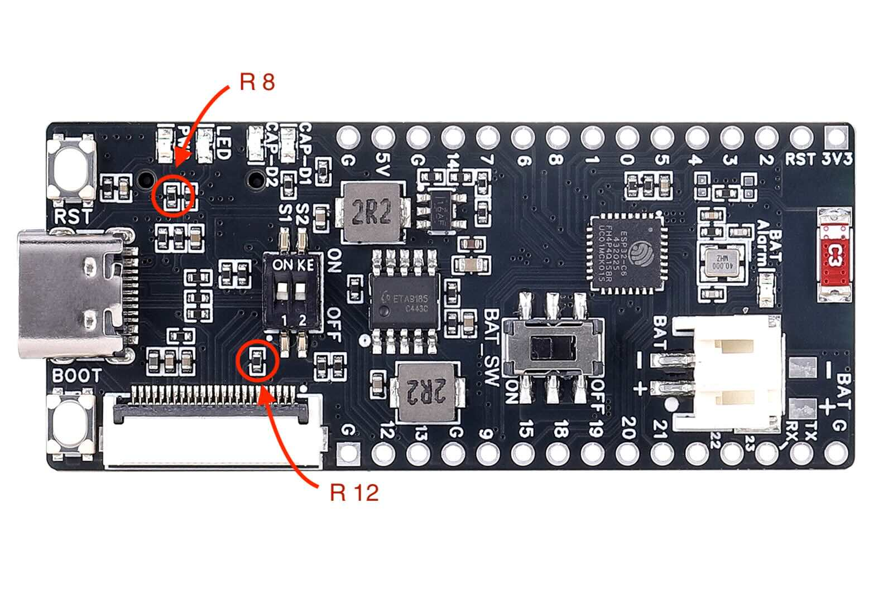
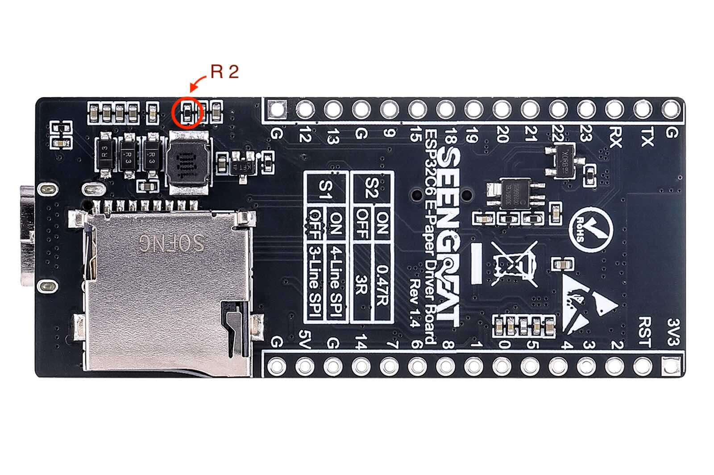
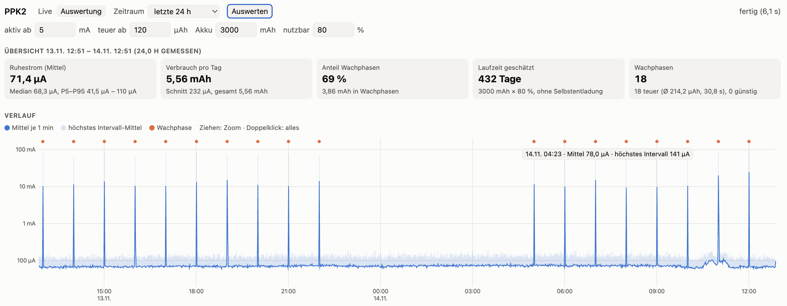

# Hardware

**Deutsch** | [English](hardware.en.md)

## Seengreat ESP32-C6 E-Paper Driver Board

Hersteller-Wiki: [seengreat.com/wiki/198](https://seengreat.com/wiki/198/esp32c6-e-paper-driver-board#toc15)

Pinbelegung aus den Seengreat-Demos:

| Signal | GPIO |
|---|---|
| BUSY | 2 |
| DC | 3 |
| MOSI (SDA) | 4 |
| SCK | 5 |
| RST | 6 |
| CS | 7 |
| LED | 8 |
| Akkuspannung (Teiler 1:2) | 0 |

Das Board ist ein ESP32-C6 und braucht deshalb den Arduino-Core 3.x. In `platformio.ini` ist dafür die Plattform `pioarduino` eingetragen statt der offiziellen `espressif32`.

## Display

Das 4,2"-Panel (BWR, 400×300) stammt aus einem SES-imagotag-Preisschild. Ein Datenblatt gibt es nicht. Es läuft mit dem GxEPD2-Treiber `GxEPD2_420c` (Controller UC8176). Die Umgebung `epd42` in `platformio.ini` zeigt ein Testbild, damit lassen sich Panel und Verkabelung ohne WLAN und Home Assistant prüfen.

### Längerer Refresh

Ein voller Refresh dauert bei diesem Panel etwa 23 s. GxEPD2 wartet beim `GxEPD2_420c` aber nur 20 s und meldet dann „Busy Timeout!“. In `src/wetter/main.cpp` erhöht die Klasse `EPD_SES42` die Wartezeit deshalb auf 40 s.

## Akku

- **Typ:** eine Zelle Li-Ion/LiPo, 3,7 V nominal, 4,2 V voll, **mit Schutzschaltung**. Kein LiFePO4, die Ladeschaltung lädt auf 4,2 V.
- **Stecker:** Die Polarität vor dem Einstecken mit der Beschriftung am Board vergleichen. JST-PH-Akkus gibt es mit beiden Belegungen.
- **Messung:** GPIO0 über einen Teiler 1:2. Ohne Akku misst der Teiler die Ladespannung (über 4,25 V), dann zeigt die Anzeige „USB“.
- **Anzeige:** in 5-%-Schritten zwischen 3,30 V (0 %) und 4,15 V (100 %), rot unter 3,50 V

### Gemessener Verbrauch (Nordic PPK2, 6.11.2026)

Auswertung einer Messung mit PWR-LED und R12 entfernt, R2 noch vorhanden, Display angeschlossen, noch ohne Light Sleep. Die Tabelle zeigt, wie sich ein Zyklus zusammensetzt. Aktuelle Werte und Laufzeit siehe [Langzeitmessung mit festen Pin-Pegeln](#langzeitmessung-mit-festen-pin-pegeln-1314112026):

| Bereich | Posten | Dauer | Ladung | Strom / Bemerkung |
|---|---|---|---|---|
| Zyklus | Boot, WLAN, Abrufe | ~9 s | ~140 µAh | Ø 55 mA, Spitzen über 1 A |
| Zyklus | Display-Refresh | ~22 s | ~190 µAh | konstant ~32 mA, der ESP wartet wach auf BUSY |
| Zyklus | Nachlauf | ~22 s | vernachlässigbar | Median ~42 µA |
| Ruhe | Deep Sleep | dauerhaft | – | Median ~0 µA, **Mittel 1,45 mA** durch Impulse bis ~870 mA |

Die Zyklus-Werte stammen aus dem Kaltstart. Ein Wachzyklus aus dem Deep Sleep kann etwas abweichen.

**Warum der Schlafstrom aus Impulsen besteht:** Der Boost-Wandler im ETA9185 (Akku → 5 V) arbeitet bei kleiner Last im Burst-Betrieb. Er pausiert und lädt dann in kurzen Stößen den Ausgangskondensator nach. Die Spitzen bis ~870 mA sind Spulenströme während dieser Stöße. Für den Akku zählt nur der Mittelwert. Der Median von ~0 µA bedeutet also nicht, dass das Board im Schlaf nichts verbraucht.

**Vor den Umbauten bestimmte der Schlafstrom die Laufzeit.**

### Schlafstrom senken

Im Auslieferungszustand braucht das Board im Deep Sleep **3,2 mA**. Damit hält ein 3000-mAh-Akku nur 5–6 Wochen. Der ESP32-C6 selbst braucht nur ~10 µA, der Rest geht in Bauteile auf dem Board:

| Ursache | Strom am Akku | Abhilfe | Stand |
|---|---|---|---|
| PWR-LED (D9), leuchtet immer | ~1,1 mA | LED bzw. Vorwiderstand R8 auslöten | erledigt |
| **R12** (4,7 kΩ): Pull-up an BS nach 3,3 V. S1 = ON (4-Draht-SPI) legt BS auf Masse, dann fließt dauerhaft Strom. | ~0,8–1,2 mA | R12 auslöten, S1 bleibt auf ON. Lage: einzelner Widerstand links unterhalb von Schalter 1, über der Display-Buchse (von Seengreat bestätigt). | erledigt |
| **R2** (10 kΩ): Pull-up an BUSY (GPIO2). Das Panel hält BUSY im Schlaf auf LOW (gemessen 0,08 V). | **~1,2 mA** | R2 auslöten. Die Firmware schaltet an BUSY den internen Pull-up des ESP ein. **Erst die Firmware flashen, dann auslöten.** | erledigt |
| Panel im Deep Sleep | ~0,05 mA | – | – |
| Board ohne Display (ESP, Regler, Teiler) | ~0,1 mA | – | – |

Lage der entfernten Widerstände (rot markiert):

| Oberseite: R8 (PWR-LED) und R12 (Pull-up an BS) | Unterseite: R2 (Pull-up an BUSY) |
|---|---|
|  |  |

**Ergebnis: 157 µA Schlafstrom mit Display** (7.11.2026, Mittel über 5 min). Erwartet hatten wir durch R2 nur −0,4 mA. Tatsächlich sank der Strom um 1,2 mA. Der Strom über R2 hat offenbar auch das Panel teilweise wach gehalten.

Nicht beteiligt sind:
- **CAP-D1/CAP-D2** (Vorwiderstände R23/R24): Die Ladestands-LEDs leuchten nur kurz beim Start und sind im Schlaf aus.
- **R6** (10 kΩ): liegt laut Seengreat zwischen VIN (USB) und dem NTC-Pin des ETA9185, nicht an 5 V. Im Akkubetrieb fließt dort kein Strom.
- **MOSI/SCK** (Pull-ups R57/R58 des SD-Slots): bleiben im Schlaf auf 3,3 V.

Die Firmware hält im Schlaf CS, RST, DC und den LED-Pin per Hold auf HIGH (LED aus). MOSI, SCK und BUSY bleiben hochohmig: MOSI/SCK liegen über die Pull-ups des SD-Slots auf HIGH, BUSY hält das Panel auf LOW. Früher waren auch DC und der LED-Pin hochohmig. Die beiden Eingänge schwebten, und der Schlafstrom schwankte stundenweise zwischen etwa 120 und 200 µA (PPK2-Messung 10.–13.11.2026). Mit festem Pegel sind es stabil ~70 µA, siehe [Langzeitmessung mit festen Pin-Pegeln](#langzeitmessung-mit-festen-pin-pegeln-1314112026). Die ältere Aussage, alle Display-Pins auf HIGH brächten nichts (1,4 statt 1,2 mA), stammt von vor dem Auslöten von R2 und gilt nicht mehr.

Mit dem Testprogramm `schlaftest` (`pio run -e schlaftest -t upload`) geht das Board ohne Display und WLAN sofort in den Deep Sleep. Damit lässt sich der Grundverbrauch messen.

| Schlafstrom | Laufzeit mit 3000 mAh (inkl. ~2–5 mAh/Tag für Aktualisierungen) |
|---|---|
| 3,2 mA (Auslieferungszustand) | ~5–6 Wochen |
| 1,2–1,45 mA (PWR-LED und R12 entfernt) | ~2,5–3 Monate |
| 0,15 mA (zusätzlich R2 entfernt, 24 h gemessen) | ~11 Monate, bei 80 % nutzbar ~9 Monate (267 Tage, siehe unten) |
| 0,15 mA und Light Sleep während des Refreshs (24 h gemessen) | ~13,5 Monate, bei 80 % nutzbar ~11 Monate (330 Tage, siehe unten) |
| **0,07 mA: zusätzlich DC und LED-Pin im Schlaf fest auf HIGH (24 h gemessen)** | **~17,5 Monate**, bei 80 % nutzbar **~14 Monate** (432 Tage, siehe unten) |

### Langzeitmessung über 24 h (8./9.11.2026)

Gemessen mit dem PPK2 an einem Raspberry Pi über den [PPK2 Longterm Logger](https://github.com/DocBigs-Lab/ppk2-longterm-logger), ausgewertet mit dessen `analyse.py`:

```sh
python3 analyse.py --hours 24 --raster 1800
```

Stand der Firmware: Commit „Schlafstrom gesenkt, Müll-Banner, Terminliste verbessert“, alle drei Widerstände entfernt, Akkubetrieb.

| Posten | Wert | Bemerkung |
|---|---|---|
| Ruhestrom | Ø 150 µA | 99,4 % der Zeit. Nachts ~140 µA, mittags bis ~169 µA, vermutlich temperaturabhängig |
| Wachphasen | 18 | stündlich 5–22 Uhr, wie geplant |
| davon mit Neuzeichnen | 17 | Ø 312 µAh, 31 s |
| davon ohne Neuzeichnen | 1 | 84 µAh, 7 s |
| Ladung pro Neuzeichnen | ~230 µAh | Differenz der beiden Fälle |
| Tagesverbrauch | **9,0 mAh** | Wachphasen 5,4 mAh (60 %), Ruhe 3,6 mAh |
| Laufzeit 3000 mAh × 80 % | **267 Tage** | |

Ergebnisse:

- **Die Wachphasen bestimmen jetzt die Laufzeit**, nicht mehr der Schlafstrom.
- **Fast jede Stunde wird neu gezeichnet.** Die Prüfsumme enthält die gemessene und die vorhergesagte Außentemperatur auf ganze Grad. Eine der beiden ändert sich fast immer.
- **Zeitplan hält:** Die stündlichen Wachphasen liegen innerhalb von ±6 s um die volle Stunde. Nach der Nachtpause wachte das Board um 04:56:33 auf (207 s zu früh, 0,8 % über 7 h). Die Firmware wertet das als den 5-Uhr-Termin, ein zweites Aufwachen kurz nach 5 gab es nicht.

### Langzeitmessung mit Light Sleep (9./10.11.2026)

Gleicher Aufbau, Firmware mit Commit „Light Sleep während des Display-Refreshs“ (`LIGHT_SLEEP_REFRESH 1`). Der ESP schläft, während das Panel ~22 s auf BUSY arbeitet, statt wach zu warten. Gemessen von 18:46 bis 18:46 Uhr.

| Posten | Wert | Bemerkung |
|---|---|---|
| Ruhestrom | Ø 147 µA | 99,4 % der Zeit, Median 144 µA. Stündliche Mittel zwischen 144 und 151 µA |
| Wachphasen | 18 | alle mit Neuzeichnen |
| Ladung pro Wachphase | Ø 209 µAh, 31 s | vorher Ø 312 µAh, also ~100 µAh (33 %) weniger. Meist 170–225 µAh, Ausreißer um 18 Uhr mit 398 µAh und 38 s |
| Tagesverbrauch | **7,3 mAh** | Wachphasen 3,8 mAh (52 %), Ruhe 3,5 mAh |
| Laufzeit 3000 mAh × 80 % | **330 Tage** | vorher 267 Tage |

Ergebnisse:

- **Das Bild ist sauber**, der Light Sleep stört den Refresh nicht.
- **Die Dauer bleibt gleich** (31 s). Gespart wird nur Strom, denn das Panel braucht für den Refresh so lange, wie es braucht.
- **Weniger gespart als geschätzt:** erwartet waren ~170 µAh pro Neuzeichnen, gemessen sind es ~100 µAh. Das Panel und der 5-V-Wandler ziehen während des Refreshs weiter Strom, nur der ESP-Anteil fällt weg.
- **Wachphasen und Ruhe teilen sich den Verbrauch jetzt etwa hälftig.** Wieder wurde jede Stunde neu gezeichnet. Weniger Neuzeichnen ist damit der nächste Hebel.

### Langzeitmessung mit festen Pin-Pegeln (13./14.11.2026)

Aktueller Stand. Gleicher Aufbau, Firmware mit Commit „Deep Sleep: DC und LED-Pin per Hold auf HIGH statt schwebend“. Im Deep Sleep liegen DC und der LED-Pin jetzt fest auf HIGH, statt zu schweben. Gemessen vom 13.11. 12:51 bis 14.11. 12:51 Uhr.



| Posten | Wert | Bemerkung |
|---|---|---|
| Ruhestrom | **Ø 71 µA** | 99,4 % der Zeit, Median 68 µA. Stündliche Mittel zwischen 66 und 76 µA, auch nachts. Vorher Ø 147 µA |
| Wachphasen | 18 | alle mit Neuzeichnen, Ø 214 µAh, 31 s. Meist 155–260 µAh, Ausreißer um 11 und 12 Uhr mit 354 und 410 µAh |
| Tagesverbrauch | **5,6 mAh** | Wachphasen 3,9 mAh (69 %), Ruhe 1,7 mAh |
| Laufzeit 3000 mAh × 80 % | **432 Tage** | vorher 330 Tage |

Ergebnisse:

- **Der Ruhestrom hat sich halbiert** (147 → 71 µA) und ist stabil. Vorher schwankte er stundenweise zwischen 120 und 200 µA, in der Nacht 12./13.11. lag er bei 170–198 µA. Jetzt bleiben alle Stunden im Band 66–76 µA.
- **Die schwebenden Eingänge haben also nicht nur die Schwankung verursacht, sondern auch den Grundstrom erhöht.** Die Aufschlüsselung in [Schlafstrom senken](#schlafstrom-senken) (Panel ~0,05 mA, Board ~0,1 mA) stammt von vorher und ist damit zu hoch.
- **Die Wachphasen sind unverändert** (Ø 214 statt 209 µAh). LED und Refresh funktionieren wie bisher.
- **Die Wachphasen machen jetzt gut zwei Drittel des Verbrauchs aus.** Seltener neu zu zeichnen bringt damit relativ noch mehr.

Was sich daraus machen lässt, steht in der README unter [Verbesserungs- und Optimierungsmöglichkeiten](../README.md#verbesserungs--und-optimierungsmöglichkeiten).
